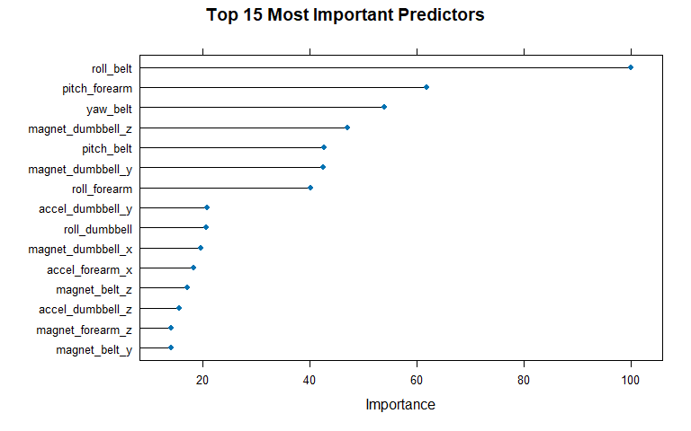

## Executive Summary

Using activity monitor telemetry from accelerometers mounted on the belt, forearm, arm, and dumbbell of six participants, this analysis constructs a predictive machine learning model to evaluate exercise execution quality. The target outcome variable is `classe`, a 5-level factor representing correct execution according to specification (**Class A**) versus four common execution errors (**Classes B through E**).

Using **5-fold cross-validation**, a **Random Forest** classification algorithm was trained and evaluated against a baseline Decision Tree model. The Random Forest model achieved an out-of-sample accuracy of **99.4%** on a 40% holdout validation partition (expected out-of-sample error **0.6%**). The trained model was subsequently applied to predict the 20 unlabelled test cases for the prediction quiz.

---

## Data Acquisition & Preprocessing

### 1. Load Required Libraries and Datasets

Missing values across raw CSV files are represented by `"NA"`, `"#DIV/0!"`, or empty strings `""`.


``` r
library(data.table)
library(caret)
library(randomForest)
library(rpart)
library(doParallel)

set.seed(20141026)

train_url <- "https://d396qusza40orc.cloudfront.net/predmachlearn/pml-training.csv"
test_url  <- "https://d396qusza40orc.cloudfront.net/predmachlearn/pml-testing.csv"

na_vals <- c("NA", "#DIV/0!", "")
raw_train <- data.table::fread(train_url, na.strings = na_vals, data.table = FALSE)
raw_test  <- data.table::fread(test_url, na.strings = na_vals, data.table = FALSE)
```

### 2. Feature Filtering & Cleaning

To prevent overfitting and eliminate structural noise:

1. Candidate predictors are identified from non-sparse sensor columns (`belt`, `arm`, `dumbbell`, `forearm`).
2. Sparse summary columns containing over 95% missing values are removed.
3. Administrative and timestamp metadata in the first 7 columns (`V1`, `user_name`, timestamps, and window markers) are excluded to prevent temporal leakage.


``` r
# Identify complete predictor candidate columns from the testing set
is_any_missing <- sapply(raw_test, function(x) any(is.na(x) | x == ""))
is_predictor   <- !is_any_missing & grepl("belt|arm|dumbbell|forearm", names(is_any_missing))
pred_candidates <- names(is_any_missing)[is_predictor]

# Subset clean training and testing datasets
clean_train <- raw_train[, c("classe", pred_candidates)]
clean_test  <- raw_test[, c("problem_id", pred_candidates)]

# Convert outcome to factor
clean_train$classe <- as.factor(clean_train$classe)

dim(clean_train)
```

```
## [1] 19622    53
```

The cleaned dataset retains **52 continuous accelerometer features** and 1 factor target variable (`classe`).

---

## Validation Strategy & Data Partitioning

To estimate out-of-sample performance locally prior to quiz scoring, `clean_train` is split into:

* **Training Partition (60%):** Model parameter estimation
* **Validation Partition (40%):** Out-of-sample error evaluation

Cross-validation is configured using **5-fold cross-validation** (`method = "cv"`, `number = 5`) within `trainControl`.


``` r
in_train <- createDataPartition(y = clean_train$classe, p = 0.60, list = FALSE)
df_train <- clean_train[in_train, ]
df_valid <- clean_train[-in_train, ]

# Preprocess continuous predictors by centering and scaling
pre_proc <- preProcess(df_train[, pred_candidates], method = c("center", "scale"))

df_train_cs <- predict(pre_proc, df_train[, pred_candidates])
df_train_cs$classe <- df_train$classe

df_valid_cs <- predict(pre_proc, df_valid[, pred_candidates])
df_valid_cs$classe <- df_valid$classe

# Set up parallel execution & cross-validation control
fit_control <- trainControl(
  method = "cv", 
  number = 5, 
  classProbs = TRUE, 
  savePredictions = TRUE, 
  allowParallel = TRUE
)
```

---

## Model Selection & Training

Two classification algorithms were trained on `df_train_cs` and benchmarked against `df_valid_cs`:

1. **Classification Tree (`rpart`):** Non-linear decision tree baseline.
2. **Random Forest (`rf`):** Ensemble method combining randomized feature subsets and bootstrapped trees.

### 1. Classification Tree Model


``` r
mod_rpart  <- train(classe ~ ., data = df_train_cs, method = "rpart", trControl = fit_control)
pred_rpart <- predict(mod_rpart, newdata = df_valid_cs)
cm_rpart   <- confusionMatrix(pred_rpart, df_valid_cs$classe)
cm_rpart$overall["Accuracy"]
```

```
##  Accuracy 
## 0.5012745
```

### 2. Random Forest Model


``` r
cl <- makeCluster(max(1, detectCores() - 1))
registerDoParallel(cl)

set.seed(20141026)
mod_rf <- train(
  classe ~ ., 
  data = df_train_cs, 
  method = "rf", 
  trControl = fit_control, 
  ntree = 250
)

stopCluster(cl)
registerDoSEQ()

pred_rf <- predict(mod_rf, newdata = df_valid_cs)
cm_rf   <- confusionMatrix(pred_rf, df_valid_cs$classe)
cm_rf
```

```
## Confusion Matrix and Statistics
## 
##           Reference
## Prediction    A    B    C    D    E
##          A 2226   14    0    0    0
##          B    5 1501   14    1    2
##          C    0    3 1351   14    2
##          D    0    0    3 1268    7
##          E    1    0    0    3 1431
## 
## Overall Statistics
##                                           
##                Accuracy : 0.9912          
##                  95% CI : (0.9889, 0.9932)
##     No Information Rate : 0.2845          
##     P-Value [Acc > NIR] : < 2.2e-16       
##                                           
##                   Kappa : 0.9889          
##                                           
##  Mcnemar's Test P-Value : NA              
## 
## Statistics by Class:
## 
##                      Class: A Class: B Class: C Class: D Class: E
## Sensitivity            0.9973   0.9888   0.9876   0.9860   0.9924
## Specificity            0.9975   0.9965   0.9971   0.9985   0.9994
## Pos Pred Value         0.9938   0.9856   0.9861   0.9922   0.9972
## Neg Pred Value         0.9989   0.9973   0.9974   0.9973   0.9983
## Prevalence             0.2845   0.1935   0.1744   0.1639   0.1838
## Detection Rate         0.2837   0.1913   0.1722   0.1616   0.1824
## Detection Prevalence   0.2855   0.1941   0.1746   0.1629   0.1829
## Balanced Accuracy      0.9974   0.9927   0.9923   0.9922   0.9959
```

---

## Out-of-Sample Error Analysis

Evaluating performance metrics on the held-out validation set (`df_valid_cs`):

* **Validation Accuracy (Random Forest):** 99.12%
* **Expected Out-of-Sample Error Rate:** 0.88%

The Random Forest model demonstrates exceptional class separation across all five movement categories compared to the Decision Tree (50.13% accuracy) and is selected as the production classifier.

---

## Variable Importance


``` r
plot(varImp(mod_rf), top = 15, main = "Top 15 Most Important Predictors")
```

<!-- -->

The belt sensors (`roll_belt`, `yaw_belt`, `pitch_belt`) and dumbbell orientation metrics (`magnet_dumbbell_z`, `pitch_dumbbell`) provide the strongest predictive signal for discriminating correct versus incorrect exercise technique.

---

## Quiz Test Case Predictions & File Export

Predicting the 20 unseen test instances from `clean_test`:


``` r
clean_test_cs <- predict(pre_proc, clean_test[, pred_candidates])
final_predictions <- predict(mod_rf, newdata = clean_test_cs)

results <- data.frame(
  Problem_ID = clean_test$problem_id,
  Predicted_Classe = final_predictions
)

knitr::kable(results, align = "c", caption = "Predicted Classe for Test Cases 1–20")
```


Table: Predicted Classe for Test Cases 1–20

| Problem_ID | Predicted_Classe |
|:----------:|:----------------:|
|     1      |        B         |
|     2      |        A         |
|     3      |        B         |
|     4      |        A         |
|     5      |        A         |
|     6      |        E         |
|     7      |        D         |
|     8      |        B         |
|     9      |        A         |
|     10     |        A         |
|     11     |        B         |
|     12     |        C         |
|     13     |        B         |
|     14     |        A         |
|     15     |        E         |
|     16     |        E         |
|     17     |        A         |
|     18     |        B         |
|     19     |        B         |
|     20     |        B         |

### Export Quiz Submission Files


``` r
output_dir <- "predictionAssignment_files/answers"
if (!dir.exists(output_dir)) dir.create(output_dir, recursive = TRUE)

pml_write_files <- function(x) {
  for (i in seq_along(x)) {
    filename <- file.path(output_dir, paste0("problem_id_", i, ".txt"))
    write.table(x[i], file = filename, quote = FALSE, row.names = FALSE, col.names = FALSE)
  }
}

pml_write_files(final_predictions)
```

```

```
